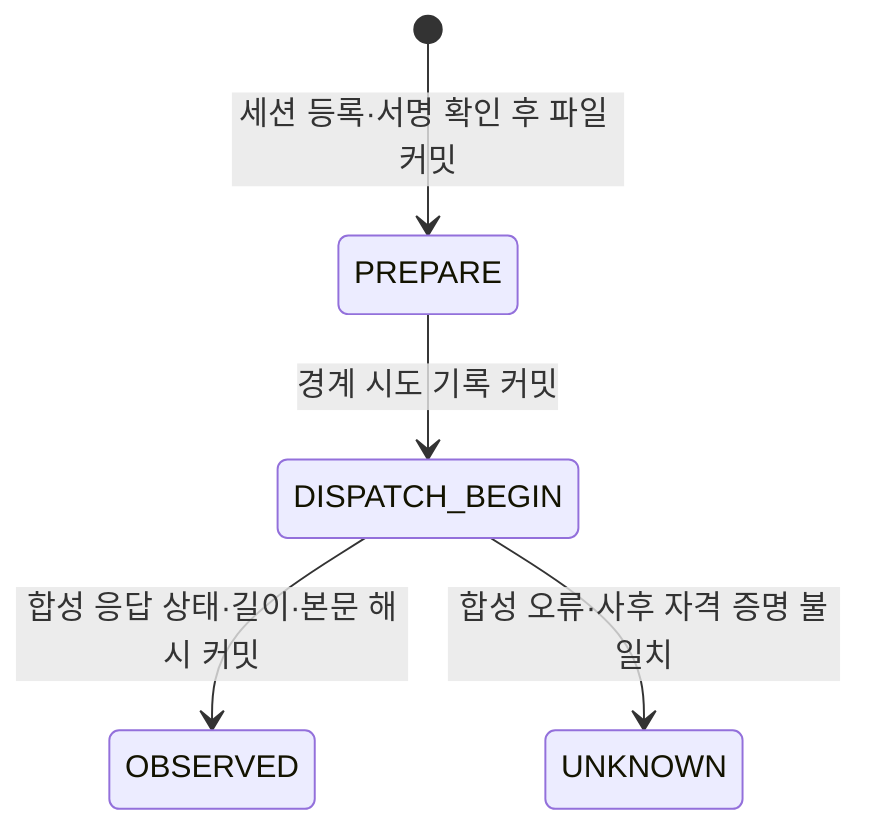

# 전송 직전 요청·자격 증명 세션 감사 계약 후보

실제 전송 경로에 연결하지 않은 합성 전용 계약과 파일 기록 모델을 구현했다. 기존 DemoClient·주문 코디네이터·V2 GET 감사 테이블·Windows 설치 파일을 바꾸지 않는다. 실제 HTTP·주문·listenKey·자동 복구·거래 재개 경로를 추가하지 않는다.

## 계약의 범위

`services/execution/demo_wire_session_contract_candidate.py`의 CredentialSession은 API key/secret을 프로세스 메모리에 복사해 보관한다. 새 객체마다 무작위 세션 UUID를 발급하며 같은 키로 다시 등록해도 이전 UUID를 계승하지 않는다. 계정/공유 scope 라벨을 고정하고 소유 프로세스 PID·종료 상태·단조 시계 기준 최대 12시간 수명을 검사한다. fork·종료·만료·시계 역행 이후에는 사용할 수 없다. 키·서명·키 지문을 파일에 저장하지 않는다. 세션·준비 객체의 pickle 직렬화를 거부하며, 세션 복사도 거부한다. close는 사용을 막고 세션이 가진 참조를 해제하지만 Python 메모리 전체의 안전한 소거를 보장하지 않는다.

prepare는 실제 전달받은 서명 질의의 HMAC과 API key를 메모리의 세션 자격 증명과 대조한다. 서명 앞의 정확한 질의 바이트 해시와 정규화한 허용 파라미터·timestamp/recvWindow를 기록 대상으로 만든다. query/key가 준비 이후 바뀌면 경계 직전·직후 재검사에서 거부한다. 로컬 키/secret으로 HMAC이 맞는다는 사실은 Binance가 그 키를 수락했다거나 원격 계정 신원이 확인됐다는 뜻이 아니다.

준비 객체는 해당 소유 세션에서 한 번만 소비할 수 있다. 복제한 준비 객체·다른 세션·종료된 세션으로 교체할 수 없다. 대기 준비 객체는 세션당 64개로 제한한다. 준비 객체의 record()는 키와 서명이 제거된 메타데이터 사본만 반환한다.

지원 범위는 다음과 같다.

- ENTRY: BTCUSDT LIMIT 주문 계약의 정확한 수량·가격·방향·timeInForce·client ID.
- EXIT: BTCUSDT MARKET/reduceOnly=true의 실제 전달 질의 수량·방향·client ID. 과거 진입 수량이나 조회 응답 origQty로 대체하지 않는다.
- STOP_LOSS: 별도 STOP_MARKET/CONDITIONAL/closePosition=true/MARK_PRICE/priceProtect=FALSE 알고리즘 계약. quantity/reduceOnly를 섞지 않는다.
- READ: 서명된 원래 주문·알고리즘 주문·accountConfig·account GET. 같은 살아 있는 소유 세션으로 처리하면 같은 로컬 세션 UUID에 연결된다.

POST에는 IntentPin 참조가 필요하다. 이 핀은 기존 의도 기록을 가리키는 내용 참조이며, 이번 모델이 원래 의도 이벤트의 진위를 인증하거나 금융 DB와 원자적으로 결합하지는 않는다. DELETE·listenKey·TP algo·MARKET 신규 진입 등 범위 밖 요청은 거부한다.

## 합성 전용 기록 순서

SyntheticWireJournal과 SyntheticResponder는 합성 경계 테스트용이다. 기본값은 비활성이고 생성·실행에 각각 명시적 선택이 필요하다. 임의 전송 함수나 responder 하위 클래스를 주입할 수 없다. responder는 RESTResponse 데이터 또는 합성 실패만 반환하는 고정 구현이며 네트워크를 호출하지 않는다. 실제 주문 권한·리스크·호출 한도 심사를 대체하지 않는다.

PREPARE와 DISPATCH_BEGIN이 append/fsync된 뒤에만 합성 responder를 호출한다. BEGIN은 호출 시도 경계 표시이며 실제 네트워크에 바이트가 도달했다는 증명이 아니다. OBSERVED는 오류 HTTP 상태를 포함한 응답 관측일 뿐 주문 성공이나 청산 완료 판정이 아니다.

소유자 전용 0700 디렉터리·0600 일반 파일을 사용하고 심볼릭 링크·하드 링크·권한 불일치를 거부한다. 파일은 새로 만들 때 O_EXCL/O_NOFOLLOW를 사용하고, 이후 순서 번호·이전 해시·내용 해시 체인으로 추가한다. 최대 256개 기록·512 KiB이며 한 번의 PREPARE/BEGIN/응답 기록을 위한 공간을 먼저 확보한다. 응답 원문·헤더는 저장하지 않고 SHA-256·길이·HTTP 상태만 저장한다. 원래 주문 식별자와 주문 조건은 파일에 있으므로 비공개로 유지해야 한다.

부분 쓰기·fsync·감사 기록 실패는 성공 응답을 반환하지 않는다. 파일 기록 실패나 현재 파일 끝 불일치 후에는 writer를 영구 차단한다. 파일을 원상 복원해도 살아 있는 writer를 다시 사용하지 못한다. UNKNOWN 이후에는 후속 기록·재시도·자동 환불·자동 복구가 없다. 한 journal 안에서 이미 기록된 POST 식별자는 다른 세션으로도 재사용하지 못한다. 이 모델은 다른 journal 전체를 통합하는 전역 중복 방지 서비스를 제공하지 않는다.

## 보장하지 않는 것

파일 해시 체인의 구조 검증은 외부 신뢰 앵커가 아니다. 유효한 이전 prefix로 파일 전체를 되돌린 경우 새 읽기 전용 검토자는 그 롤백을 독립적으로 판별할 수 없다. 현재 writer는 메모리의 끝 값과 다르면 거부하지만, 재시작한 writer를 여는 API는 제공하지 않는다. root 환경은 SYNTHETIC_ONLY로 고정하며 읽기 전용 재생만 가능하다.

local_signature_checked는 메모리 소유자가 검사했다고 남긴 로컬 기록이다. 독립 파일 검토자가 키·서명 없이 그 HMAC을 다시 검증할 수 있다는 주장이 아니다. 임의 로컬 코드를 실행해 메모리나 파일을 함께 바꿀 수 있는 공격자를 격리하는 보안 경계도 아니다.

모든 보고서에서 다음은 false다: 실제 전송 증명, 원격 계정 신원, 원래 의도 진위, 금융 DB 커밋 결합, 외부 롤백 보호, 주문 권한, 이력 보관 허가, 실행·주문·LIVE 승인. 프로세스 재시작 후 세션/전송 재개도 지원하지 않는다. timestamp 서명을 검사하지만 시계 신뢰·거래소 신선도·TTL 원격 유효성은 따로 검증해야 한다.

## 검증과 후속 경계

테스트는 합성 키·응답과 실제 비공개 파일·스레드 잠금만 사용한다. 동시 준비 객체 재사용, 서명/키 교체, 다른 세션, 복사·직렬화, 12시간 만료, fork·시계 역행, 경계 전후 변조, 파일 실패, 재시도 차단, 청산 질의 수량 보존, 유효 prefix 롤백 한계까지 확인한다. 기존 제출 의도 연결·응답 판정·V2 증거 경로의 PG/SQLite 회귀 테스트도 실행했다. 세부 결과는 WIRE_SESSION_CONTRACT_CANDIDATE_VALIDATION.json에 기록한다.

실제 사용 전에 필요한 후속 작업은 이 계약을 독립 체크포인트·세션 등록 기록·금융 의도 트랜잭션과 연결해 롤백·커밋 간격을 검증하는 것이다. 그 뒤에도 원격 고유 계정 신원 출처, 권한·호출 한도·리더 fencing, 시계/신선도, 운영 설치·복구 검토가 남는다. 기존 Windows의 미해결 요청 4건·34개 주문 이력·용량 부족은 변경하거나 해결하지 않았다.
